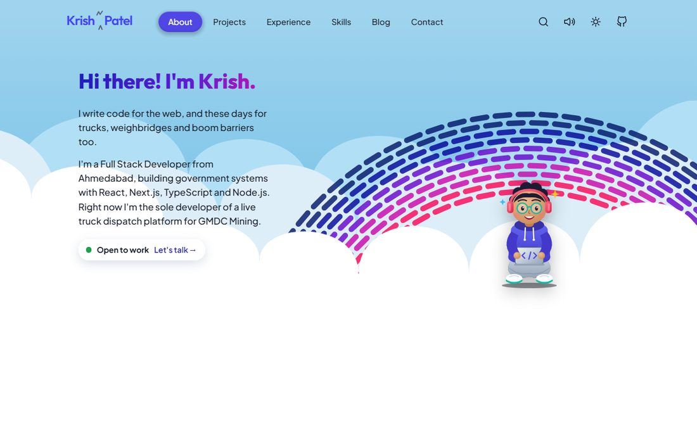
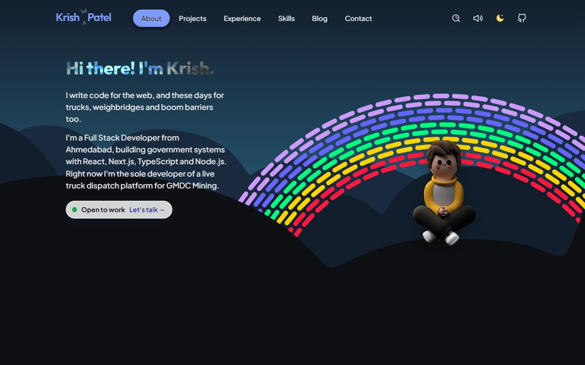
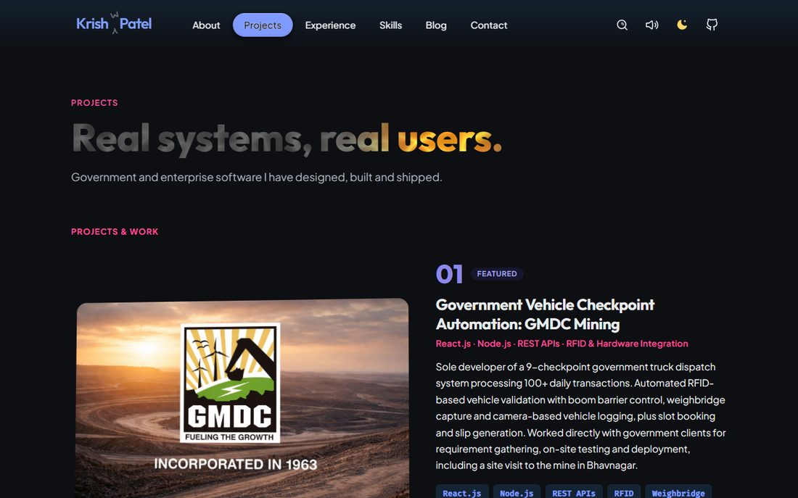

<div align="center">

# Krish Patel · Portfolio

### A hand-built, interactive developer portfolio, with a blog, a real map, synthesized sound and a serverless contact form

**[www.krishpatel.website](https://www.krishpatel.website)**


</div>

---

## Table of contents

1. [Overview](#-overview)
2. [Screenshots](#-screenshots)
3. [Features](#-features)
4. [Tech stack](#-tech-stack)
5. [Pages and routes](#-pages-and-routes)
6. [Getting started](#-getting-started)
7. [Environment variables](#-environment-variables)
8. [Project structure](#-project-structure)
9. [Architecture](#-architecture)
10. [Adding content](#-adding-content)
11. [Performance](#-performance)
12. [Accessibility](#-accessibility)
13. [SEO](#-seo)
14. [Security](#-security)
15. [Responsive design](#-responsive-design)
16. [Deployment](#-deployment)
17. [Quality checks](#-quality-checks)
18. [Roadmap](#-roadmap)
19. [Credits](#-credits)
20. [License and contact](#-license-and-contact)

---

## 🎯 Overview

This is the source code of my personal portfolio, **[krishpatel.website](https://www.krishpatel.website)**. It presents my work as a Full Stack Developer from Ahmedabad, India: government and enterprise systems built with React, Next.js, Node.js and AWS, plus an AI coding agent, a client website and a browser game.

The site is built **by hand**: there is no UI kit, no CSS framework and no router library. Every component, every line of CSS, the router, the pre-rendering build step and the blog engine are written for this project. It is about **17,000 lines** of JavaScript and CSS (not counting content).

The goals were simple:

- **Show how I build**, not only say it, through real interactions, real numbers and readable code.
- **Be fast and accessible** on any device, from a small phone to a large desktop.
- **Be found**: every page is pre-rendered to real HTML with its own title, description, social card and structured data.

---

## 🖼️ Screenshots

| Light mode | Dark mode |
| :---: | :---: |
|  |  |
|  |  |

---

## ✨ Features

### Pages and content
- **Home (About)** with an animated hero, a generative rainbow, a real visitor map, a waving flag, drum pads, a chai counter and more small interactions.
- **Projects** with five featured projects and a **case study page** for each: GMDC Mining Dispatch, RepoSentry, Auralyx, EMBERLEAF and this portfolio.
- **Experience** with a timeline, education and certifications. **Skills** with tabbed, flip-able 3D cards.
- **Blog** with a post list, article pages, a reading-friendly layout, live code playgrounds and a settings panel for the rainbow.
- **Contact** with a validated form, plus a one-line email box in the footer. A downloadable PDF resume is included.
- **Search** across projects, skills, experience and blog posts, with the matching text highlighted.

### Interaction and visual design
- **Light and dark themes** with an animated switch: every colour token is a registered CSS `@property`, so gradients, fills and borders fade together instead of snapping.
- **WebGL fluid cursor** drawn behind page titles and the contact page, loaded only after the page has painted and the browser is idle.
- **Masked headings**: titles cut out of a photo texture and lit by a spotlight that follows the mouse.
- **Generative rainbow** on a canvas, where every dash bends toward the cursor.
- **Real map** with MapLibre GL and free CARTO basemaps (no API key), loaded lazily.
- **Synthesized sound**: every effect (pop, chime, whoosh, toggle, drum kit) is generated live with the Web Audio API. There are no audio files, and a global switch turns sound off.
- **3D flip cards**, a gooey navigation pill, animated icons, confetti and a day and night sky.

### Engineering
- **Pre-rendering**: every route is rendered to static HTML at build time.
- **Code splitting**: each page is its own JavaScript file, downloaded on demand.
- **Serverless contact API** with validation, a honeypot field, rate limiting, a database record and an email notification.
- **Responsive** from 320px phones up to wide desktops, with larger tap targets on touch screens.
- **SEO ready**: canonical URLs, Open Graph and Twitter cards, JSON-LD structured data and a generated sitemap.

---

## 🧰 Tech stack

| Area | Tool | Version | What it is used for |
| --- | --- | --- | --- |
| UI | **React** | 19 | Components, hooks, server rendering at build time |
| Build | **Vite** | 8 | Dev server, production bundles, SSR build |
| Animation | **GSAP** | 3 | Masked heading reveals, timelines |
| Animation | **Framer Motion** | 14 | Layout and entrance animations, the mobile menu |
| Maps | **MapLibre GL** | 6 | The real visitor map (CARTO basemaps) |
| Database | **Supabase** (`@supabase/supabase-js`) | 2 | Stores contact messages (server side only) |
| Email | **Resend** (REST API) | n/a | Notification and optional auto-reply emails |
| Effects | **canvas-confetti** | 1 | Confetti on clicks |
| Icons | **react-icons** | 5 | Feather, Simple Icons and Font Awesome icons |
| Linting | **Oxlint** | 1 | Fast linting with React rules |
| Hosting | **Vercel** | n/a | Static hosting and the serverless function |
| Language | JavaScript (ES modules), CSS | n/a | No TypeScript and no CSS framework |

Fonts are loaded from Google Fonts: **Plus Jakarta Sans**, **Outfit**, **Fira Code** and **Poppins**.

---

## 🗺️ Pages and routes

| Route | Page | Notes |
| --- | --- | --- |
| `/` | Home (About) | Hero, rainbow, map and interactive cards |
| `/projects` | Projects | The five featured projects |
| `/projects/gmdc` | Case study | GMDC Mining Dispatch (own page) |
| `/projects/reposentry` | Case study | RepoSentry, an AI GitHub coding agent |
| `/projects/auralyx` | Case study | Auralyx clinic website |
| `/projects/emberleaf` | Case study | EMBERLEAF browser platformer |
| `/projects/portfolio` | Case study | This portfolio |
| `/experience` | Experience | Timeline, education, certifications |
| `/skills` | Skills | Tabbed 3D skill cards |
| `/blog` | Blog | Post list |
| `/blog/how-i-built-my-portfolio` | Blog post | The long-form write-up of this site |
| `/contact` | Contact | Form, links and the resume |
| `/api/contact` | Serverless function | `POST` only |

Unknown addresses show a real **404 page** (served with a 404 status). `/about` and `/index.html` redirect to `/`, and the non-`www` domain redirects to `www`.

---

## 🚀 Getting started

**Requirements:** [Node.js](https://nodejs.org) **20.19 or newer** (22 recommended) and npm.

```bash
# 1. Clone the repository
git clone https://github.com/KrishPatel511/portfolio2026.git
cd portfolio2026

# 2. Install dependencies
npm install

# 3. Create your environment file (only needed for the contact form)
cp .env.example .env

# 4. Start the development server  →  http://localhost:5173
npm run dev
```

The site runs without any environment variables. Only the **contact form** needs them (see below).

### Scripts

| Script | What it does |
| --- | --- |
| `npm run dev` | Starts the Vite dev server with hot reload |
| `npm run build` | The full production build: client bundle, server bundle, then **pre-rendering** of every page and the sitemap |
| `npm run build:client` | Only the client bundle (no pre-rendering) |
| `npm run preview` | Serves the built site locally |
| `npm run lint` | Lints the code with Oxlint |

> **Tip:** `npm run preview` does not know about clean URLs such as `/projects/gmdc`, because Vercel handles those in production. To test deep links locally, use a small static server that maps `/path` to `/path/index.html`, or test on a Vercel preview deployment.

---

## 🔐 Environment variables

Copy `.env.example` to `.env` for local use, and add the same keys in **Vercel → Project → Settings → Environment Variables**. These are used only by `api/contact.js`.

| Variable | Required | Description |
| --- | :---: | --- |
| `SUPABASE_URL` | ✅ | Your Supabase project URL |
| `SUPABASE_SERVICE_ROLE_KEY` | ✅ | Server-only key used to write contact messages |
| `RESEND_API_KEY` | ✅ | API key for sending email through Resend |
| `CONTACT_TO_EMAIL` | ✅ | The address that receives new messages |
| `CONTACT_FROM_EMAIL` | optional | The sender. Defaults to Resend's test sender, which can only email your own Resend account address until a domain is verified |
| `AUTOREPLY_ENABLED` | optional | Set to `true` to email visitors a thank-you note. Needs a verified sending domain |

> ⚠️ **Never** prefix these with `VITE_` (that would put them in the browser bundle), and never commit a real `.env` file. `.env` is listed in `.gitignore`.

### Database setup (Supabase)

Run the migration in `supabase/migrations/001_contact_messages.sql` in the Supabase SQL editor. It creates the `contact_messages` table with:

- length checks on `name` (1 to 100), `email` (3 to 254) and `message` (1 to 2000 characters)
- a `status` column (`new`, `read`, `replied`, `spam`) and an `email_sent` flag
- a hashed IP and the user agent, for rate limiting
- indexes on the creation time and on the hashed IP
- **row level security switched on with no policies**, so the public (anon) key can neither read nor write. Only the server function, using the service-role key, can write.

---

## 🗂️ Project structure

```
design-new-portfolio/
├─ index.html                     HTML shell: fonts, theme colour, mount point
├─ vite.config.js                 Vite config and the #pages alias (lazy vs static)
├─ vercel.json                    Clean URLs, redirects, security and cache headers
├─ package.json                   Scripts and dependencies
├─ .env.example                   The environment variables the contact API needs
│
├─ api/
│  └─ contact.js                  Serverless function: validate, rate limit, store, email
│
├─ supabase/
│  └─ migrations/                 SQL for the contact_messages table
│
├─ scripts/
│  └─ prerender.mjs               Build step: renders every route to HTML, writes the sitemap
│
├─ public/                        Static files, served as they are
│  ├─ cv/                         The PDF resume
│  ├─ images/, projects/, blog/   Project pictures and article screenshots
│  ├─ certifications/, education/, experience/   Logos
│  └─ og-image.jpg, favicon.svg, robots.txt
│
└─ src/
   ├─ main.jsx                    Browser entry: starts the router, preloads the first page
   ├─ entry-server.jsx            Server entry used by the pre-render step
   ├─ App.jsx                     Chooses the page for the current URL
   ├─ pages.lazy.jsx              Browser build: every page is a lazy-loaded chunk
   ├─ pages.static.jsx            Server build: pages are imported normally
   │
   ├─ seo/routes.js               One list of routes: titles, descriptions, JSON-LD, priorities
   ├─ utils/
   │  ├─ router.js                A small History API router
   │  ├─ pages.js                 Path → page map and the navigation links
   │  ├─ seo.js                   Keeps <title>, meta tags and JSON-LD in sync on navigation
   │  ├─ soundEffects.js          Web Audio sound effects
   │  └─ drumSounds.js            The synthesized drum kit
   │
   ├─ blog/
   │  ├─ meta.js                  The post list (title, date, tags, ...)
   │  └─ content.js               The article text as a list of blocks
   │
   ├─ context/                    Theme and sound providers
   ├─ hooks/useSound.js           A small sound hook
   ├─ styles/                     reset, design tokens, global styles, theme transition
   │
   └─ components/
      ├─ About/                   Home page, rainbow art, real map
      ├─ Blog/                    Blog list, article page, code, playground, widgets
      ├─ Content/                 Projects, skills, experience and education page
      ├─ Pages/                   Contact, 404, case studies
      ├─ Header/  Footer/         Navigation, mobile menu, search, footer
      ├─ MaskedHeading/           Photo-masked headings with a spotlight
      ├─ SplashCursor/            WebGL fluid simulation (lazy-loaded)
      ├─ StarBorder/  TiltedCard/  GooeyNav/    Buttons, 3D cards and the nav pill
      └─ Hero/                    Cloud shapes shared by the hero
```

---

## 🏗️ Architecture

### A tiny router

`src/utils/router.js` is a small router built on the browser's History API. A map in `src/utils/pages.js` turns a path into a page name, and unknown paths become a real 404 page. Clicks on internal links become client-side navigation, the back button works through `popstate`, and old `#hash` links are redirected to the new real URLs.

### Pre-rendering

A client-side React app starts as an empty page, which is poor for search engines and slow phones. So the build does this:

```
vite build                              →  the browser bundle  (dist/)
vite build --ssr src/entry-server.jsx   →  a server bundle     (.ssr/)
node scripts/prerender.mjs              →  renderToString() once per route
```

For each route, `scripts/prerender.mjs` writes a real HTML file with:

- the page content,
- the title, description, canonical link, Open Graph and Twitter tags,
- JSON-LD structured data,
- links to **that page's own CSS and JavaScript** (read from Vite's manifest), so the page is styled before any script runs.

It also writes `404.html` and **`sitemap.xml`** from the same route list. The page is then replaced by the live React app once it has loaded.

### Code splitting with one alias

In the browser, each page is its own JavaScript file, downloaded when needed. The server build needs the opposite (plain imports, so the HTML contains the content). One alias in `vite.config.js` swaps the file:

```js
alias: { '#pages': pagesFile(isSsrBuild ? 'pages.static.jsx' : 'pages.lazy.jsx') }
```

`src/main.jsx` downloads the current page's chunk **before** starting React, so the pre-rendered content never flashes away. After the first page is up, the other pages are fetched quietly when the browser is idle. Already-loaded pages render synchronously, which avoids a one-frame flash of the footer.

### One source for SEO

`src/seo/routes.js` is the single list of routes. The same data feeds the page titles, the social cards, the JSON-LD, the breadcrumbs, the sitemap and the blog posts' schema, so the metadata can never drift away from the content.

### Theming

Colours, fonts and spacing are CSS variables (`src/styles/tokens.css`). Dark mode is a second set of values under `data-color-mode="dark"`. `src/styles/theme-transition.css` registers each colour with `@property`, so the browser can animate between themes.

### Content lives in code

There is no CMS. Projects, skills, experience and blog posts are plain JavaScript data that the page components read. A change is a normal commit and a redeploy.

### The blog engine

- `src/blog/meta.js`: the list of posts (slug, title, subtitle, date, tags, category).
- `src/blog/content.js`: each post is a list of **blocks**: headings, paragraphs, lists, code, side notes (info, success, warning, error), tool cards, figures, before/after frames, an editable playground and the interactive rainbow.
- `BlogPostPage.jsx` renders the blocks. Code is coloured by a small tokenizer (`BlogCode.jsx`) and has a copy button.
- The **like** heart is stored only in your own browser and counts nothing on a server.

### The contact pipeline

```
Visitor ──▶ ContactPage / Footer form ──▶ POST /api/contact
                                              │
        1. honeypot field filled?  ───────────┤  yes: pretend success (bots)
        2. validate name, email, message ─────┤  invalid: 400
        3. rate limit: 5 per 10 min per IP ───┤  too many: 429
        4. insert into Supabase (RLS on) ─────┤  failed: 500
        5. email me through Resend ───────────┤  failure is logged, the message stays saved
        6. optional auto-reply to the visitor ┘
```

The IP address is **hashed** before it is stored, so no raw address is kept.

### Interactive pieces

| Piece | How it works |
| --- | --- |
| **SplashCursor** | A WebGL fluid simulation. A lazy wrapper loads it after the page is painted and the browser is idle, so it never delays content. |
| **MaskedHeading** | Text is an SVG mask over a photo, with a spotlight and parallax that follow the pointer. Its font size is also set in CSS, so the pre-rendered title is already the right height. |
| **RainbowArt** | Canvas drawing of rows of dashes on arcs. On a phone it is drawn smaller to fit. |
| **RealMap** | MapLibre GL, imported lazily, with a theme-aware CARTO basemap. |
| **Sound** | Oscillators and gain envelopes from the Web Audio API, behind one global on/off switch. |
| **TiltedCard** | A 3D tilt and flip card used on the Skills page. |

---

## 📝 Adding content

### A new project

1. Add a card to the `PROJECTS` list in `src/components/Content/PortfolioContent.jsx`.
2. Add its case study to `CASE_STUDIES` in `src/components/Pages/ProjectCaseStudy.jsx`.
3. Register the route in four small places: `src/utils/pages.js` (path and case-study list), `src/pages.lazy.jsx` (`LOADER_FOR_PAGE`), `scripts/prerender.mjs` (`PAGE_SOURCE`) and `src/seo/routes.js` (title, description, schema).
4. Optionally add it to the search list (`SearchModal.jsx`), the footer and the mobile menu.
5. Put its picture in `public/projects/`.

### A new blog post

1. Add an entry to `POSTS` in `src/blog/meta.js`.
2. Add the text to `BODIES` in `src/blog/content.js`, under the same slug. The block types are listed at the top of that file.
3. Run `npm run build`. The page, its SEO data and its sitemap entry are generated automatically.

### A new page

Add the component, register it in `pages.lazy.jsx` and `pages.static.jsx`, add a path in `utils/pages.js`, and add its SEO entry in `seo/routes.js`.

---

## ⚡ Performance

I measure with **Lighthouse (mobile, throttled)** on a local production build, taking the median of three runs, because a single run can swing a lot. Lab numbers differ from real phones, so treat them as a guide.

| What changed | Before | After |
| --- | --- | --- |
| Main JavaScript file | 723 KB (246 KB gzip) | **438 KB (140 KB gzip)** |
| Largest project image | 2.27 MB PNG | **239 KB JPG** |
| Projects page, Largest Contentful Paint | 18.8 s | **8.8 s** |
| Projects page, download size | 3.9 MB | **1.7 MB** |
| Lighthouse performance (Home / Projects) | 50 / 50 | **55 / 59** |

What helped, in order of impact: shrinking the biggest image, splitting the code by page, linking each page's own CSS and JavaScript in its pre-rendered HTML, and loading the heavy WebGL effect only when idle.

**Known next step:** the Google Fonts stylesheet still blocks the first paint. An async version improved the first paint but raised layout shift from 0 to 0.9, so it was reverted. Self-hosting the fonts with preloading is the planned fix.

---

## ♿ Accessibility

- **Lighthouse accessibility: 96 to 100** on the pages tested.
- Every media query uses **`rem`** (39 of them, none in pixels), so layouts adapt when a user raises their browser's font size.
- **Reduced motion** is respected: animations are switched off in 19 places when the user asks for less motion.
- One `h1` per page, a `main` landmark, a logical heading order and accessible names for buttons, links and form fields.
- Text and tint colours were checked against contrast rules in both themes.
- Touch targets are enlarged on phones.

---

## 🔎 SEO

- Each page has its own `<title>`, description, canonical URL, Open Graph and Twitter tags.
- **JSON-LD**: `Person` and `WebSite` on the home page, `CreativeWork` and breadcrumbs on case studies, and `Blog` and `BlogPosting` on the blog.
- `sitemap.xml` and `robots.txt`, generated from the same route list.
- A real 404 status for unknown pages, and one canonical host (`www`).

---

## 🔒 Security

- **Secrets stay on the server.** The service-role and email keys are read only inside `api/contact.js`.
- **Database locked down**: row level security is on with no public policies.
- **Input checks and limits**: lengths, an email pattern, HTML escaping in emails, a honeypot field and per-IP rate limiting with a hashed address.
- **Headers**: `X-Content-Type-Options: nosniff` and `Referrer-Policy: strict-origin-when-cross-origin`, plus long-lived caching for hashed assets.
- The playground in the blog runs user code inside a **sandboxed `iframe`** without access to the page.

---

## 📱 Responsive design

The site is checked from **320px** phones to tablets and wide desktops, in light and dark mode.

- The hero art scales with the screen and moves up on phones so the whole rainbow arch is visible.
- Skills cards sit two to a row on phones. Buttons fill the row, and the footer links wrap inside their columns.
- Blog code blocks and side notes are restyled for narrow screens, and the page never scrolls sideways.

---

## ☁️ Deployment

The project deploys on **Vercel** with no extra configuration beyond `vercel.json`:

1. Import the GitHub repository in Vercel and keep the detected **Vite** preset (build command `npm run build`, output `dist`).
2. Add the environment variables from the table above.
3. Add the domain `www.krishpatel.website` and let the apex domain redirect to it.
4. Every push to `main` redeploys. Pull requests get preview URLs.

`vercel.json` also sets clean URLs (no `.html`), the redirects above, security headers and cache rules.

---

## ✅ Quality checks

```bash
npm run lint     # Oxlint, with React hooks and component rules
npm run build    # must complete: it also pre-renders all routes
```

There are **no automated tests yet**. Quality is checked by building, linting, Lighthouse runs, scripted browser checks of navigation, forms and layout at several screen widths, and manual testing.

---

## 🧭 Roadmap

- Self-host the fonts with preloading, to cut the first paint without shifting the layout.
- Add real testimonials, once the people involved have agreed to be quoted.
- More blog posts.
- Basic analytics to see which pages and projects are actually used.
- Automated tests for the router and the contact function.

---

## 🙏 Credits

- **Libraries**: [React](https://react.dev), [Vite](https://vite.dev), [GSAP](https://gsap.com), [Framer Motion](https://www.framer.com/motion/), [MapLibre GL](https://maplibre.org), [Supabase](https://supabase.com), [canvas-confetti](https://github.com/catdad/canvas-confetti), [react-icons](https://react-icons.github.io/react-icons/) and [Oxlint](https://oxc.rs).
- **Services**: [Vercel](https://vercel.com) for hosting, [Supabase](https://supabase.com) for the database and [Resend](https://resend.com) for email.
- **Map**: basemaps by [CARTO](https://carto.com/basemaps/), with data © [OpenStreetMap](https://www.openstreetmap.org/copyright) contributors.
- **Fonts**: Plus Jakarta Sans, Outfit, Fira Code and Poppins, from [Google Fonts](https://fonts.google.com).
- **Client and project assets**: logos, photos and screenshots of client work (such as GMDC Mining) belong to their respective owners.

---

## 📄 License and contact

© 2025 to present **Krish Patel**. All rights reserved. The code is published so that people can read and learn from it. Please **ask before reusing** the text, projects, images or the overall design. Third-party libraries keep their own licenses.

**Let's talk**

- 🌐 Website: [www.krishpatel.website](https://www.krishpatel.website)
- 💼 LinkedIn: [linkedin.com/in/krishpatel511](https://www.linkedin.com/in/krishpatel511)
- 🐙 GitHub: [github.com/KrishPatel511](https://github.com/KrishPatel511)
- 📬 Email: [krishpatel51151@gmail.com](mailto:krishpatel51151@gmail.com)
